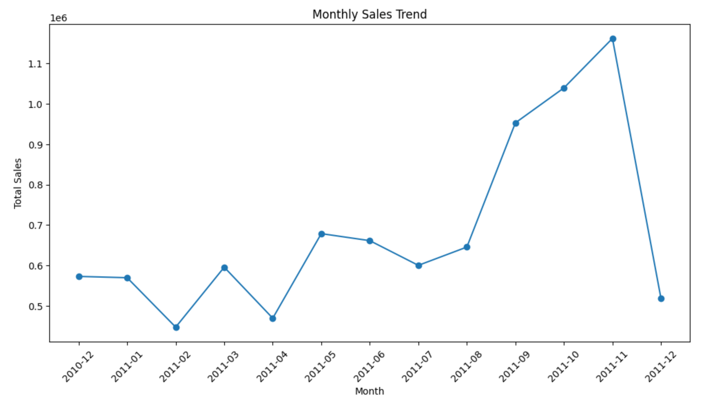
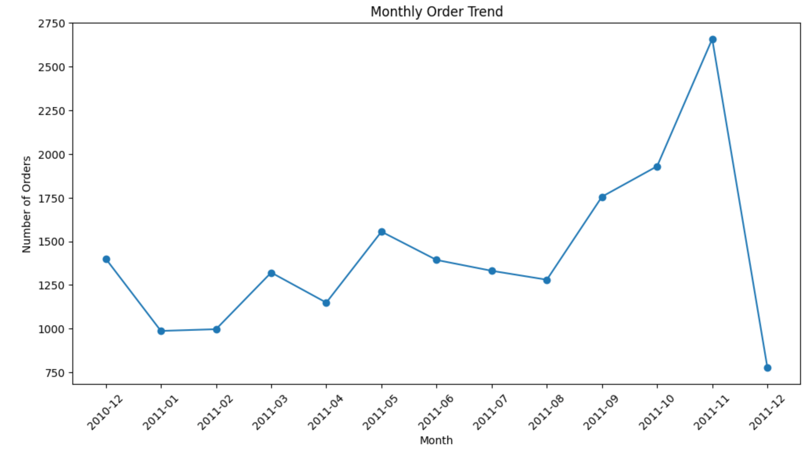
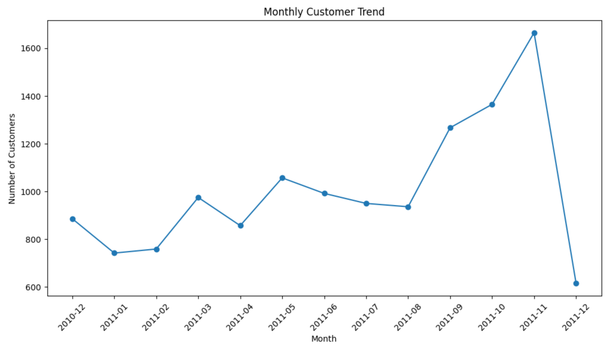
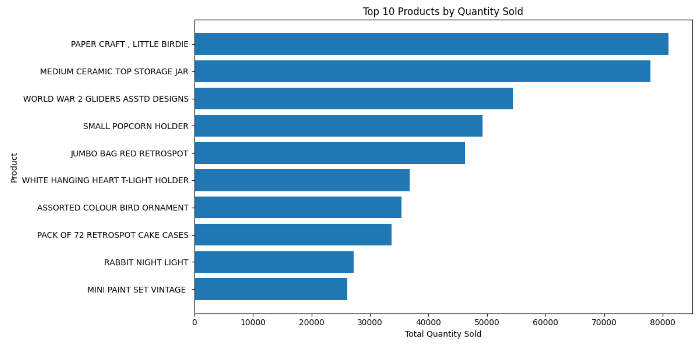
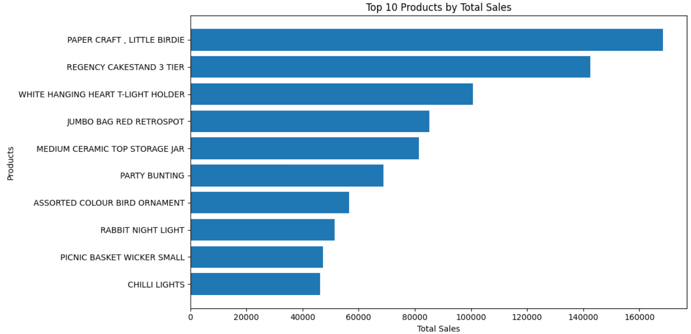
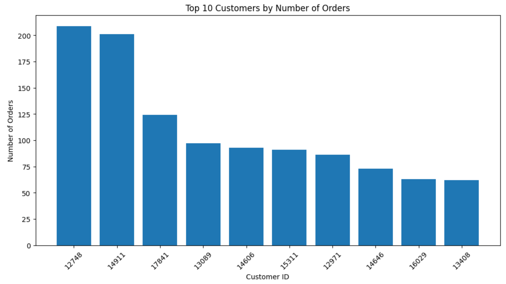
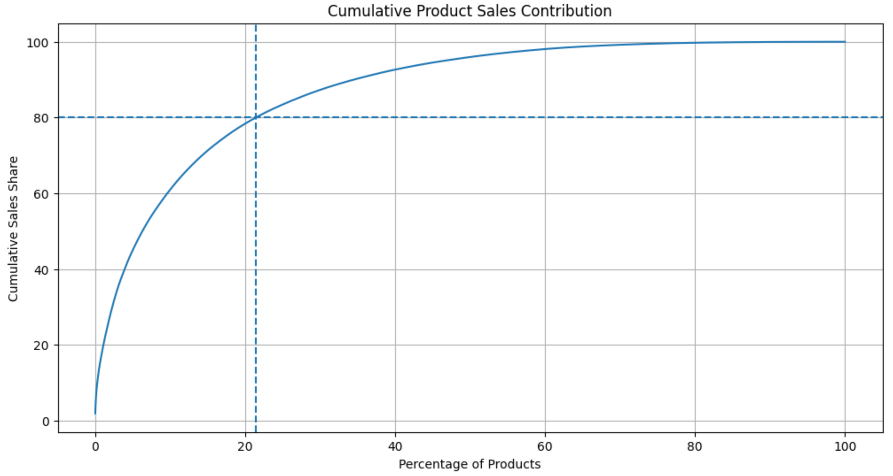
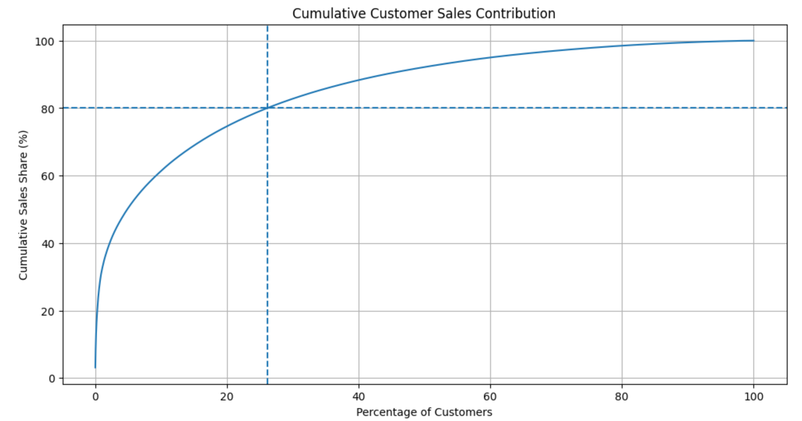

# UK Online Retail Sales Data Analysis

Business-focused sales analysis of the UCI Online Retail dataset, built as a GitHub portfolio project for data analyst internship applications. The project uses Python, pandas, Excel, and data visualization to summarize sales performance, customer activity, monthly trends, and product revenue concentration.

## Project Objective

The goal of this project is to answer practical retail business questions:

- What are the key revenue, order, customer, and product KPIs after cleaning?
- How did sales, order volume, and active customer activity change over time?
- Which products contributed the most revenue and quantity sold?
- How concentrated is revenue among top products and customers?
- What business actions should the retailer prioritize based on the analysis?

This project is intentionally focused on business data analysis, not machine learning.

## Dataset

Source: [UCI Machine Learning Repository - Online Retail](https://archive.ics.uci.edu/dataset/352/online%2Bretail)

The dataset contains transaction records from a UK-based online retailer between December 2010 and December 2011. Local raw and cleaned Excel files are not included in the GitHub repository. To reproduce the analysis, download the dataset from UCI and place the local file at:

```text
data/online_retail.xlsx
```

## Tools

- Python
- pandas
- matplotlib
- openpyxl
- Jupyter Notebook
- Microsoft Excel

## Repository Structure

```text
.
├── README.md
├── requirements.txt
├── notebooks/
│   └── 01_data_loading.ipynb
├── images/
│   ├── monthly_sales_trend.png
│   ├── monthly_order_trend.png
│   ├── monthly_customer_trend.png
│   ├── top_10_products_by_quantity_sold.png
│   ├── top_10_products_by_total_sales.png
│   ├── top_10_customers_by_number_of_orders.png
│   ├── cumulative_product_sales_contribution.png
│   └── cumulative_customer_sales_contribution.png
├── report/
│   └── UCI ONLINE RETAIL REPORT.docx
└── docs/
    └── project_summary.md
```

## Project files and Excel dashboard

The original analysis was carried out in Python and pandas and documented in a notebook and a written report. An **initial Excel dashboard was also prepared separately**, but that original dashboard workbook has not been uploaded to this repository. The later, more complete dashboard below comes from an **AI-assisted reconciliation**, not the original independently written notebook.

| Deliverable | Where to view it | Scope |
| --- | --- | --- |
| Original Pareto calculation (78.65%) | [Historical notebook with saved output](https://github.com/ZZZZZXX/uk-online-retail-sales-analysis/blob/41ec18ec80a17b9243cfc22edca37c310b312439/01_data_loading.ipynb) | Original Python/pandas analysis; all 3,665 StockCodes were included, including some postage and service codes. |
| Current early-project notebook | [Jupyter notebook](notebooks/01_data_loading.ipynb) | An early-analysis variant excluding specific service codes from the ranking; it reports 78.38%. |
| Written project report | [UCI ONLINE RETAIL REPORT.docx](report/UCI%20ONLINE%20RETAIL%20REPORT.docx) | Report available in this repository. |
| Published Excel dashboard | [View Excel dashboard in the later reconciled repository](https://github.com/ZZZZZXX/-uci-online-retail-business-analytics/blob/main/output/Online_Retail_Dashboard.xlsx) | Publicly available, later AI-assisted expanded dashboard; **not identical to the initial independently created workbook**. |
| Revised concentration (78.32%) | [Later reconciled analysis](https://github.com/ZZZZZXX/-uci-online-retail-business-analytics) | Different completed-sale eligibility and normalised merchandise-code rules. |

This distinction matters when using the portfolio for applications: the original analysis, written report, initial Excel work, and later AI-assisted reconciliation should not be presented as one independently authored code pipeline.

## Key Results

The following figures are from the **early customer-identified transaction subset**, not all 541,909 invoice lines. That subset retained rows with `Quantity > 0`, `UnitPrice > 0`, and a non-null `CustomerID`.

- Raw dataset size: **541,909** invoice lines
- Early eligible-sales subset: **397,884** lines
- Recorded sales value within that subset (`Quantity × UnitPrice`): **£8,911,407.90** (not audited revenue)
- Distinct invoices: **18,532**; identified customers: **4,338**
- Distinct `StockCode` values before special-code exclusions: **3,665**
- September–November 2011 showed stronger recorded sales, order counts and active-customer activity; December 2011 is incomplete. These are descriptive observations, not established causal effects.

### Why the portfolio shows 78.65% and 78.38%

The **same early transaction filters** support two historical product-code analyses. The difference is which `StockCode` values enter the ranking and its denominator:

| Definition | Codes in ranking | Top 20% count (rounded up) | Share of sales value in that ranking | Reproducible evidence |
| --- | ---: | ---: | ---: | --- |
| All `StockCode` values, including postage / service-like entries | 3,665 | 733 | **78.65%** | [Historical root notebook, saved output](https://github.com/ZZZZZXX/uk-online-retail-sales-analysis/blob/41ec18ec80a17b9243cfc22edca37c310b312439/01_data_loading.ipynb) |
| Exclude nine predefined non-merchandise / special-code labels (only some occur in the subset) | 3,660 | 732 | **78.38%** | [Current `notebooks/01_data_loading.ipynb`](notebooks/01_data_loading.ipynb) |

The exclusions in the second definition are `POST`, `M`, `D`, `DOT`, `BANK CHARGES`, `AMAZONFEE`, `CRUK`, `C2`, and `S`. These are **different definitions of what counts as a product code**, not conflicting arithmetic. The current notebook saves **78.38%**; the historical root notebook (later removed as a duplicate file) saves **78.65%**.

A [separate, later reconciled descriptive analysis](https://github.com/ZZZZZXX/-uci-online-retail-business-analytics) reports **78.32%** for the top 20% of **3,790 normalised merchandise codes**. It uses revised sale eligibility and code-normalisation rules, so **78.32% is not a like-for-like recomputation** of the two early results. It also documents that sales lines with missing customer identity represent **16.49% of gross completed-sales value** under its revised definition.

**Interpretation:** Sales are concentrated in a relatively small group of codes. This alone does **not** establish profit contribution, optimal inventory levels, or the effect of changing assortment; the source has no cost, margin or stock data.

## Visualizations

### Monthly Sales Trend



### Monthly Order Trend



### Monthly Customer Trend



### Top Products by Quantity Sold



### Top Products by Total Sales



### Top Customers by Number of Orders



### Product Revenue Concentration



### Customer Revenue Concentration



## Business questions for further investigation (not implemented recommendations)

- Test whether the observed September–November increase repeats in additional years before using it for inventory or logistics planning.
- Investigate stock availability for high-sales-value products **after obtaining cost, margin, stock and fulfilment data**; concentration alone does not justify inventory allocation.
- Evaluate bundles and repeat purchasing as hypotheses using appropriate basket, customer and outcome data; these effects were **not measured** in this descriptive project.
- Treat the incomplete December 2011 period separately from full-month comparisons.

## How to Run

1. Clone the repository.
2. Download the Online Retail dataset from UCI.
3. Place the Excel file at `data/online_retail.xlsx`.
4. Install dependencies:

```bash
pip install -r requirements.txt
```

5. Open and run the notebook:

```bash
jupyter lab notebooks/01_data_loading.ipynb
```

The notebook exports the filtered data table to a workbook named `Online_Retail_Dashboard.xlsx` in its working directory. **That export is a flat worksheet, not the full multi-sheet dashboard.** The separately created original Excel dashboard is not hosted here. A [later AI-assisted reconciled dashboard](https://github.com/ZZZZZXX/-uci-online-retail-business-analytics/blob/main/output/Online_Retail_Dashboard.xlsx) is publicly available, with its own documented workflow; it should not be mistaken for the initial workbook.

## Limitations

- The early `df_clean` subset excludes non-positive quantities / prices and missing-`CustomerID` rows, so its sales-value figures do **not** cover all completed sales. Customer-ID exclusions are not appropriate for every product-level question.
- Treating all `StockCode` values as merchandise leads to 78.65%; excluding predefined non-product codes leads to 78.38%. Neither percentage is a universal property of the raw data without its definition.
- The later reconciled project's 78.32% uses different transaction and normalised merchandise definitions; it should not be presented as the direct impact of a single filter.
- December 2011 is a partial month and should not be compared directly with full months.
- The dataset lacks costs, margins, stock availability, order fulfilment and experimental outcomes. These analyses are descriptive, not evidence of profitability, causal effects, forecasts or completed inventory optimisation.
